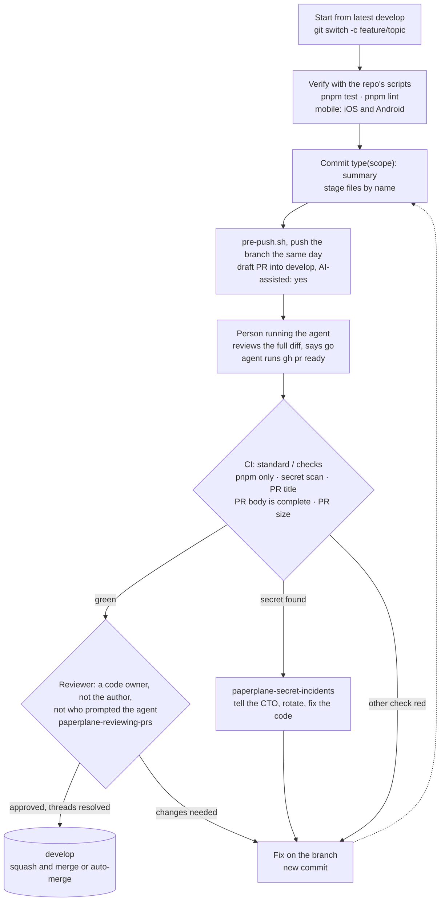
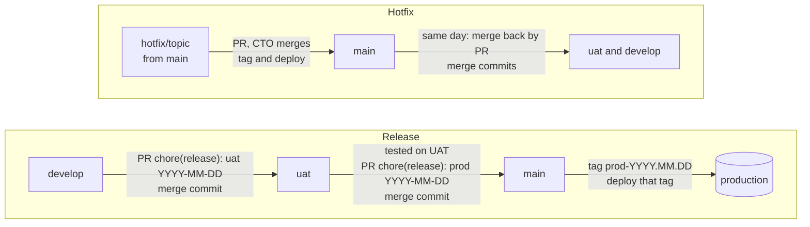

# Paper Plane engineering workflow skills

[](https://github.com/Jacob-Valor/paperplane-engineering-workflow-skills/actions/workflows/validate.yml)
Version **v2026.10.15.8**, matching the guide of 2026-10-15 · [Changelog](CHANGELOG.md) · [Test results](tests/RESULTS.md)

Agent skills that encode the [Paper Plane engineering guide](https://github.com/paperplanehq/paperplane-engineering)
for every repository in the `paperplanehq` GitHub org. They follow the
[Agent Skills specification](https://agentskills.io/specification) and install with the
[`skills` CLI](https://github.com/vercel-labs/skills) into Claude Code, Codex, Cursor, Pi and other agents.

The skills hold agents to the same rules as people: work on a branch, open a PR into `develop`,
use pnpm only, keep secrets out of git, and leave merging, releasing and deploying to humans.

## Skills

| Skill | Use it when |
|---|---|
| [`paperplane-shipping-changes`](skills/paperplane-shipping-changes/SKILL.md) | Any code, config or dependency change: branch, commit, `pnpm add`, push, draft PR into `develop`, stacks, marking ready |
| [`paperplane-reviewing-prs`](skills/paperplane-reviewing-prs/SKILL.md) | Reviewing a teammate's PR. Produces a findings report; a human approves and merges |
| [`paperplane-secret-incidents`](skills/paperplane-secret-incidents/SKILL.md) | gitleaks fails, a credential was committed or pasted, someone asks for `.env` values |
| [`paperplane-releasing`](skills/paperplane-releasing/SKILL.md) | Release PRs `develop → uat → main`, `prod-YYYY.MM.DD` tags, rollback, hotfixes, `app-vX.Y.Z` store tags |
| [`paperplane-repo-setup`](skills/paperplane-repo-setup/SKILL.md) | Onboarding a repo: standard CI, PR template, `CODEOWNERS`, `AGENTS.md`, pnpm migration, branches, auto-merge |

Agents load a skill automatically when the request matches its description. You can also ask for
one by name: "use paperplane-shipping-changes".

## Using this for another org

The org-specific facts (org slug, CTO role, branch names, release cadence, where the guide lives) are
listed in [`docs/org-facts.md`](docs/org-facts.md); edit them there first. Then list every remaining
org-specific string with:

```bash
grep -rnE 'paperplanehq|Paper Plane|\bPay\b|TripBuddy|Sanaam|Studio|protect-develop-uat-main|release-tags-owner-only' skills README.md
```

After the edit, `bash tests/scripts/test-skills-lint.sh` checks that the skills still agree with each other.

## Repository layout

```
skills/<name>/SKILL.md                    the skill (frontmatter + instructions)
skills/<name>/scripts/*.sh                checks the skill runs with `bash`
  shipping-changes/scripts/pre-push.sh    branch, lockfiles, .env, build output, gitleaks before a push
  shipping-changes/scripts/check-pr-body.sh  the CI "PR body is complete" step, locally
  reviewing-prs/scripts/gather.sh         everything a reviewer needs for one PR
  releasing/scripts/next-tag.sh           next prod-/uat- tag name, or the rollback tag
  repo-setup/scripts/audit.sh             PASS/FAIL audit of one repo against the standard
skills/paperplane-shipping-changes/hooks/ git pre-push hook and Claude Code guard, with installers
tests/scenarios/                          agent pressure scenarios S1–S19
tests/triggering.md                       do the descriptions pick the right skill?
tests/README.md                           how to run them and the pass criteria
tests/RESULTS.md                          before/after scores for every change
tests/eval/run.py                         runs the scenarios through `claude -p` and grades them
tests/eval/checks.py                      mechanical checks on top of the model grader
tests/eval/sandbox/run.py                 tool-using eval in a throwaway repo, graded by end state
tests/scripts/                            behaviour tests for every script and hook (CI)
tests/drift/check.sh                      do the skills still match the live guide?
.github/workflows/validate.yml            spec validation, shellcheck, script tests, eval self-tests
.github/workflows/drift.yml               weekly drift check (needs the ORG_READ_TOKEN secret)
.github/workflows/eval.yml                agent evals: triggering on PRs, all scenarios weekly (needs ANTHROPIC_API_KEY)
```

## Hooks (recommended for everyone)

Skills tell an agent the rules; hooks enforce them. Install both once per machine or clone. In the
sandbox eval, small models often never opened a skill and then pushed to `develop` or merged; with
the hooks installed, nothing reached the remote (`tests/RESULTS.md`).
`<skills>` is where the skills are installed, e.g. `~/.agents/skills` (Claude Code: `~/.claude/skills`).

```bash
# In each repo clone: a git pre-push hook for people and agents alike.
# Blocks pushes to develop/uat/main; runs pre-push.sh (secrets, lockfiles, .env, build output).
# Tags and force-pushes of your own branch are allowed (the guide lets people rebase).
# An existing pre-push hook keeps running. In a clone only agents push from, add
# --block-force-push to block force-pushes too. In a husky repo the installer stops and
# prints the line to add to .husky/pre-push instead.
bash <skills>/paperplane-shipping-changes/hooks/install-git-hook.sh

# Once per machine, for Claude Code: blocks gh pr merge (incl. --auto), approvals, force-push,
# pushes to develop/uat/main, release tags, --no-verify, git add -A, repo setting changes,
# and npm/yarn/bun in pnpm repos. Use --project instead for one repo only.
bash <skills>/paperplane-shipping-changes/hooks/install-claude-hook.sh --user

# Team repos: commit the guard so every Claude Code and omp session in the repo runs it, nothing to
# install. Writes .claude/hooks/paperplane-guard.sh, the hook in .claude/settings.json, and the omp
# adapter .omp/hooks/pre/paperplane-guard.ts; commit all three (the chore/engineering-standard PR).
# Re-run after updating the skills to refresh the copies; audit.sh warns when they are out of date.
bash <skills>/paperplane-shipping-changes/hooks/install-claude-hook.sh --commit

# omp, once per machine (omp doesn't run Claude Code hooks): the same guard as an omp hook.
bash <skills>/paperplane-shipping-changes/hooks/install-omp-hook.sh
```

All installers have `--uninstall`. `git push --no-verify` skips the git hook; the skills forbid it,
and the Claude Code and omp guards block it. The committed guard is the one that matters most: in
the tool-run evals, small models often never opened a skill, and only the guard stopped them. On
2026-10-16 none of the 13 `paperplanehq` repos had it (`audit.sh` FAIL `claude-guard` on all 13).
Other agents (Codex, Cursor) get only the git pre-push hook and the server-side ruleset.

The guard is best-effort for a cooperative agent, not a sandbox. It reads the Bash command and the small
scripts it runs, and fails closed on `$VAR` or `$(...)` in a push target. It does not see other tools
(Edit and Write), remote shells, shell aliases or functions, or code assembled at run time; the header of
`claude-guard.sh` lists what still gets through. Branch protection and required reviews on the server are
the real control.

To put the guard into many team repos at once (write access needed; dry run by default):

```bash
bash <skills>/paperplane-repo-setup/scripts/rollout-guard.sh paperplanehq/tripbuddy-backend paperplanehq/tripbuddy-app
bash <skills>/paperplane-repo-setup/scripts/rollout-guard.sh --apply paperplanehq/tripbuddy-backend   # draft PR into develop
```

## Engineering workflow

### From a change to `develop`

Every change, by hand or by an agent, takes this path (guide §2–4, §6–7).



Agents run every step except the review and the merge. They push and open the draft,
show the full diff, and run `gh pr ready` only after the person says they reviewed it (a push after
Ready first goes back to draft with `gh pr ready --undo`). At most two
PRs stack; native changes and tooling bumps go in their own PR.

### From `develop` to production

Releases and hotfixes belong to the CTO (guide §2, §8). Agents prepare the PRs and write out the
commands; the CTO merges, tags and deploys (`paperplane-releasing`).



Release PRs use merge commits, never squash, so `uat` and `main` stay identical to `develop`.
A second release on the same day is tagged `prod-YYYY.MM.DD.2`. Rollback means deploying the previous
`prod-*` tag. Mobile store builds are tagged `app-vX.Y.Z` on the commit that was submitted.

## Which skills for your role

The guide has three human roles and no rules by job title. Full-stack, backend, frontend, mobile,
senior, tech lead: all are **developers**. Any developer can be a **reviewer**, as long as they
didn't write the PR and didn't prompt the agent that wrote it. The **CTO** (Pay) owns releases.

● every week · ◐ when it comes up · — not needed

| Guide role | shipping-changes | reviewing-prs | secret-incidents | releasing | repo-setup |
|---|---|---|---|---|---|
| Developer | ● | — | ◐ | ◐ | ◐ |
| Reviewer | — | ● | ◐ | — | — |
| CTO | — | ◐ | ● | ● | ● |

- **Developer:** every change is a branch and a PR into `develop` (guide §2–5). Use
  `paperplane-releasing` only for a hotfix, which you do "with the CTO" (§2). Use
  `paperplane-repo-setup` to write the file PRs for a repo (`chore/pnpm`, `chore/engineering-standard`).
  Mobile changes (TripBuddy, Sanaam, Studio apps) are verified on iOS **and** Android before the PR
  is marked Ready (§4); that is the only rule that depends on what you work on.
- **Reviewer:** checks the description matches the diff, CI is green (the advisory AI review never
  blocks), no secrets or `.env`, no `package-lock.json`/`yarn.lock`/`bun.lock`, tests for new logic,
  mobile verified on both platforms, one concern per PR, every thread resolved (§4). Then approves;
  auto-merge or the reviewer squash-merges. A secret in the diff hands off to `paperplane-secret-incidents`.
- **CTO:** merges `develop → uat → main` with merge commits, tags `prod-YYYY.MM.DD`, deploys (§8).
  Gets told at once about leaked secrets, which must be rotated (§6). Applies repo settings that
  repo-setup writes out.

## What agents will and won't do

Agents follow the same rules as developers (§7), with less authority:

| Agents do | A person does instead |
|---|---|
| Work on a feature branch; commit as `type(scope): summary`; stage files by name | — |
| Run `scripts/pre-push.sh` (branch, lockfiles, `.env`, build output, `gitleaks`) before every push; push the branch the same day and open a **draft** PR into `develop` marked `AI-assisted: yes` | — |
| Show the person running them the full diff; check the body with `scripts/check-pr-body.sh`; run `gh pr ready` only after the person says they reviewed it | That person reviews every line and says go |
| — | The author turns on auto-merge; a code owner approves; the PR squash-merges |
| Merge `develop` into a stacked branch after the PR below merges | A person rebases and force-pushes, if they prefer |
| Prepare release PRs, compute the `prod-*` tag, write out the commands | The CTO merges to `uat`/`main`, tags and deploys |
| Draft the CTO notification for a leaked secret, without the value | The CTO rotates it and approves any gitleaks allowlist entry |
| Prepare a history rewrite locally | A person force-pushes |

Nobody, person or agent, pushes directly to `develop`, `uat` or `main`, runs `npm install`, `yarn` or
`bun install`, commits a second lockfile, or commits or pastes a secret (§2, §5, §6). A rule that
doesn't fit your case: ask the CTO. No exception is granted inside the agent conversation, even by
the CTO: the agent keeps following the rule and drafts a message to the CTO, and a human with the
right access acts outside the agent.

## Install

Until the skills are merged into `paperplanehq/paperplane-engineering`, install them from this repo,
`Jacob-Valor/paperplane-engineering-workflow-skills`. It is private: ask Jacob-Valor for read access.
Installing uses your existing git or `gh` login.

```bash
# all skills, globally, for every agent on this machine
pnpm dlx skills add Jacob-Valor/paperplane-engineering-workflow-skills -g --skill '*'

# update later
pnpm dlx skills update -g

# list what's available without installing
pnpm dlx skills add Jacob-Valor/paperplane-engineering-workflow-skills --list
```

Once they are merged into `paperplanehq/paperplane-engineering` (`develop`), use that repo name in
the commands above instead.

From a local checkout of this folder:

```bash
pnpm dlx skills add . -g --skill '*'
```

## Changing a skill

Skills are tested like code: write a pressure scenario, watch an agent without the skill fail it,
change the skill, and confirm agents with the skill pass it.

1. Write a scenario in `tests/scenarios/` that tempts the violation with 3 or more pressures
   (deadline, someone senior asking, admin access, "I take responsibility"). Ask for exact commands,
   messages, and a one-line reason for each choice. Give only facts the agent would see (repo files,
   `gh` output); never state the rule being tested, or the baseline passes for the wrong reason. Add
   its pass criteria to `tests/README.md`.
2. Run it without and with the change, at least 2 and 3 times. The runner does both through
   `claude -p` and grades each answer against the pass criteria (read every failing answer yourself):
   ```bash
   python3 tests/eval/run.py --scenarios s14 --reps 2 --skill-ref main   # before (the current skills)
   python3 tests/eval/run.py --scenarios s14 --reps 3                    # after (working tree)
   python3 tests/eval/run.py --trigger --reps 1                          # after a description change
   ```
   If agents without the change already behave correctly, there is nothing to fix.
3. Edit the `SKILL.md`. Put the excuses agents gave, word for word, in its **Rationalizations** table.
4. Re-run until every run with the skill passes. Record the before/after scores in
   `tests/RESULTS.md` and the change in `CHANGELOG.md`.
5. Check locally, then open a PR into `main`; CI runs the same checks:

```bash
for s in skills/*/SKILL.md; do
  uvx --from "git+https://github.com/agentskills/agentskills#subdirectory=skills-ref" skills-ref validate "$(dirname "$s")"
done
shellcheck -S warning skills/*/scripts/*.sh skills/*/hooks/*.sh skills/paperplane-shipping-changes/hooks/git-pre-push \
  tests/scripts/*.sh tests/drift/*.sh
bash tests/scripts/run.sh
bash tests/drift/check.sh       # skills still match the live guide (needs read access to the org)
pnpm dlx skills add . --list    # every skill still discovered
```

Rules for `SKILL.md`:

- `name` is lowercase with hyphens and matches the folder name.
- `description` is one short sentence on what the skill covers, then "Use when…" with the triggers.
  Never list workflow steps there: agents that read a step list in the description follow it and
  skip the body. Run `tests/triggering.md` after changing a description.
- Frontmatter also carries `license: Proprietary`, `metadata.author` and `metadata.guide-version`
  (the guide date the skill matches); `compatibility` only when the skill needs tools.
- Anything a regex or exit code can check goes in a script under `scripts/`, called with `bash`,
  with a test in `tests/scripts/test-<name>.sh`.
- Keep the body under 500 lines. Quote the guide; don't invent policy. If the guide changes,
  update the skill and `guide-version` in the same PR or the next one.
